# Support Ticket Triage Agent

An interactive Python CLI that analyzes support conversations, retrieves relevant context, and recommends an automatic response, specialist routing, or human review.

Built with Rich, LangGraph, OpenAI Responses and Decisions, FastMCP, Chroma, and SQLite.

## Features

- Persistent customers, tickets, and timestamped conversation history.
- Structured extraction and triage of multiple unresolved issues.
- Customer and knowledge lookups through MCP and semantic retrieval.
- Interactive navigation, a small customer wizard, and scripted JSON input.
- Explicit checkpoint resume and optional LangSmith tracing.

Included profiles, service status, and handoff receivers use local demo integrations. Replies remain drafts; the application does not send messages or perform account operations.

## Quickstart

Requires Python 3.12+ and [uv](https://docs.astral.sh/uv/). Run these commands from the repository root.

Install dependencies:

```sh
uv sync --locked
```

Copy `.env.example` to `.env` if you do not already have one. Configure `OPENAI_API_KEY`, `OPENAI_RESPONSE_MODEL`, and `OPENAI_DECISION_MODEL`. Set `LANGSMITH_TRACING=false` unless you have configured tracing.

Prepare the knowledge index and launch the application:

```sh
uv run --locked python -m support_ticket_triage.index_knowledge
uv run --locked support-triage
```

Indexing and triage call OpenAI. Browsing customers and saving conversations work locally. Re-run index preparation after changing the knowledge sources; use `--rebuild` when changing the embedding model.

## Usage

### Interactive mode

Startup adds missing demo conversations without replacing saved data. Choose a customer or press `N` to create one, then create or continue a ticket and review its history before submitting a message.

- `N`: create a customer or ticket; `B`: go back; `0`: exit.
- `T`: reprocess the latest saved customer message.
- `R`: resume unfinished checkpoint work, when available.
- `/paste`: enter multiple lines, ending with a single `.` line.

Results show urgency, recommended action, owner, reason, and a reply draft. Customers and conversations remain available after restarting.

### Scripted mode

```sh
# Process the included demo conversations
uv run --locked support-triage --samples

# Process a JSON ticket or latest-message update
uv run --locked support-triage --ticket /path/to/ticket.json

# List available options
uv run --locked support-triage --help
```

JSON input contains `ticket_id`, `customer_id`, and either a latest `message` or an ordered `messages` array. Scripted commands print JSON results. For example, save this update as `ticket.json` and pass it to `--ticket`:

```json
{
  "ticket_id": "ticket-001",
  "customer_id": "customer-001",
  "message": {
    "message_id": "follow-up-001",
    "text": "The issue is still happening after I tried the suggested steps."
  }
}
```

Reusing a message ID with the same content keeps retries from adding duplicate history.

## Architecture

The CLI saves input to support SQLite. LangGraph reloads ticket history, gathers customer context, extracts issues, retrieves evidence, and chooses a draft response or mock handoff. A separate checkpoint SQLite stores execution state with `thread_id = ticket_id`; Chroma stores the knowledge vectors.

[](assets/diagrams/architecture.svg)

Double arrows represent read/write or request/response. The mandatory handbook loads directly; document and query embeddings default to `text-embedding-3-small`, configurable through `OPENAI_EMBEDDING_MODEL`. Responses handles extraction and drafting, while Decisions selects urgency, action, and owner for each unresolved issue.

<details>
<summary>View context, CLI and agent flows</summary>

### Customer and knowledge context

[](assets/diagrams/mcp-context-architecture.svg)

### Interactive CLI flow

[](assets/diagrams/cli-flow.svg)

### LangGraph agent flow

[](assets/diagrams/langgraph-agent-flow.svg)

</details>

## License

[MIT](LICENSE).
